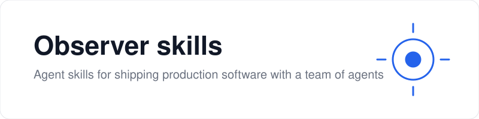
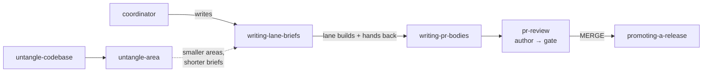

<p align="center">
  <picture>
    <source media="(prefers-color-scheme: dark)" srcset=".github/assets/banner-dark.svg">
    
  </picture>
</p>

<p align="center">
  <a href="https://skills.sh/Observerstudio/observer-skills"></a>
  <a href="https://github.com/Observerstudio/observer-skills/actions/workflows/check-skills.yml"></a>
</p>

<p align="center">
  <b>The skills Observer studio uses every day to ship production software with a team of AI agents.</b><br>
  One session coordinates, cheap lanes write the code, every PR is attacked before it merges, and releases are rehearsed on copies first.
</p>

---

## Why

Agents write code fast. Without a process, they also skip the review, merge on a green tick that tested nothing, and promote a release over a hotfix. These skills are that process, written down so any agent can follow it:

- **One coordinator, many lanes.** A strong model plans, briefs and gates; cheaper lanes implement.
- **Every PR is attacked first.** The gate assumes a defect exists, runs its own mutations, and posts what it tried.
- **Nothing ships unrehearsed.** Merges, migrations and builds run on copies before the real thing.
- **Code that stays small enough to read.** Untangle a codebase once, then keep it untangled one area at a time.

They work with Claude Code, Codex, OpenCode, pi and every agent [skills.sh](https://skills.sh/) supports.

## How they fit together



## Install

Pick **one** way per agent. Installing both gives you every skill twice.

<details open>
<summary><b>Claude Code</b> (plugin, updates itself)</summary>

```bash
claude plugin marketplace add Observerstudio/observer-skills
claude plugin install observer-skills@observer
```

</details>

<details>
<summary><b>Any agent</b> (skills.sh, copies the files)</summary>

```bash
npx skills add Observerstudio/observer-skills -g -y                              # every skill
npx skills add Observerstudio/observer-skills --skill promoting-a-release -g -y  # one skill
```

Update with `npx skills update`.

</details>

## Skills

### Start a project

| Skill | Use it when |
|---|---|
| [**choosing-a-stack**](skills/choosing-a-stack/SKILL.md) | A new project's stack is not yet chosen. Interview the lead in rounds, recommend only from the approved menu, write `docs/adr/0001-stack.md`. |

### Coordinate a work track

| Skill | Use it when |
|---|---|
| [**coordinator**](skills/coordinator/SKILL.md) | You run a whole track: diagnose, brief lanes, gate PRs, merge. Start at the [onboarding guide](skills/coordinator/docs/onboarding.md). |
| [**writing-lane-briefs**](skills/writing-lane-briefs/SKILL.md) | You hand work to a lane that will not ask questions. |
| [**pr-review**](skills/pr-review/SKILL.md) | Before opening a PR (author mode), or to gate one to MERGE or CHANGES (gate mode). |
| [**writing-pr-bodies**](skills/writing-pr-bodies/SKILL.md) | A lane hands back its PR body. Superseded by `pr` from [mattpocock/skills](https://github.com/mattpocock/skills); kept for older briefs. |
| [**audit-decisions**](skills/audit-decisions/SKILL.md) | Before merging lane work: list every decision the lane made that its brief did not cover, so the gate reviews decisions, not only the diff. |
| [**be-ambitious**](skills/be-ambitious/SKILL.md) | Before a brief, a diagnosis, a gate plan or any task worth doing well: asks what a top professional would do, the rawest material, the methods, and what outside check proves it right, then rewrites the task to ask for that. From [DannyMac180/skills](https://github.com/DannyMac180/skills) (MIT). |

### Author a skill

| Skill | Use it when |
|---|---|
| [**eval-skills**](skills/eval-skills/SKILL.md) | A skill keeps producing the wrong shape, or you have real input→expected-output cases to test it against. Runs it blind, grades the artifacts, and lets the misses drive the edits. |

### Ship a release

| Skill | Use it when |
|---|---|
| [**promoting-a-release**](skills/promoting-a-release/SKILL.md) | You promote development → staging → master, or ship a hotfix. Every step is rehearsed on a copy first. |

### Untangle a codebase

| Skill | Use it when |
|---|---|
| [**untangle-codebase**](skills/untangle-codebase/SKILL.md) | A whole repo has grown hard for agents to change safely. One pass, typed by a person. |
| [**untangle-area**](skills/untangle-area/SKILL.md) | One area of a large repo needs untangling end to end: map, decision log, tickets, proof on a production copy, and a lock. |

The untangle skills run only when a person types them; agents never start them on their own.

### Adopting in a repo

Two skills read a small file from your repo, so they follow your rules instead of ours:

| Skill | Copy this into your repo |
|---|---|
| pr-review | [`review-standards-template.md`](skills/pr-review/review-standards-template.md) → `docs/agents/review-standards.md` |
| promoting-a-release | [`promotion-template.md`](skills/promoting-a-release/promotion-template.md) → `docs/agents/promotion.md` |

The coordinator pairs with [OCH, the Observer Coordination Hub](https://github.com/Observerstudio/observer-coordination-hub), where claims, messages and shared knowledge live for every session.

## Contributing

1. Create `skills/<name>/SKILL.md`. The frontmatter `name` matches the folder, and the `description` says when to use it.
2. Add `./skills/<name>` to [`.claude-plugin/plugin.json`](.claude-plugin/plugin.json) and to a grouping in [`skills.sh.json`](skills.sh.json).
3. Run the checks CI runs on every PR:

   ```bash
   npm install --no-save yaml && node scripts/check-skills.mjs && node scripts/check-nda.mjs
   ```

   `check-nda.mjs` fails if a client name returns to any tracked file; it stores only fingerprints, never the names.

<details>
<summary>Moved from <code>Observerstudio/coordinator</code></summary>

This repo used to be `Observerstudio/coordinator`, and the old name still redirects. Skills moved from the root into `skills/<name>/`, so an install from the old layout cannot update itself: reinstall once with a command above.

</details>
